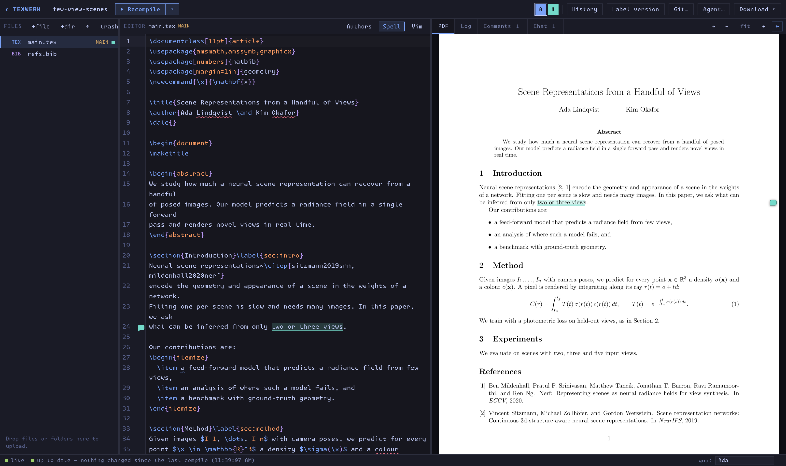

# TeXWerk

**TeXWerk is a collaborative LaTeX editor that you host yourself, by Vincent Sitzmann.**

*TeX* as in LaTeX, and *Werk* as in the German word that means "a work (of art,
literature, etc)", a factory, or a structure. It is the sibling of
[DeckWerk](https://github.com/vsitzmann/deckwerk), my slide editor, and works
the same way.

Open the server's address, pick a project, and write: file tree on the left,
editor in the middle, the compiled PDF on the right. Everyone who has the
project open sees everyone else's caret and edits live. Bring your own agent
(Claude Code, Codex, …) or your own editor with one command that mirrors the
project into a local folder and keeps it in sync both ways.



## Why TeXWerk?

My lab writes all its papers in LaTeX, together, and more and more with AI
agents. Hosted editors are good at the first part. They are not built for the
second: an agent wants a plain folder of files, a compiler and a shell, not a
web page. And the papers live on someone else's server.

TeXWerk starts from a different set of assumptions:

- A paper is a folder of ordinary files and a git repository. You can always
  `cd` into it, `git log` it, or take it elsewhere.
- An AI agent should be able to edit the same paper as a person, at the same
  time, without anyone losing a keystroke.
- Starting to write together should not require creating accounts or
  uploading a paper to a third-party service.
- It runs on one machine you already have: a lab server, a workstation, a
  laptop.

### Native agent integration

TeXWerk does not run agents and does not own an agent account. **Agent…**
gives every collaborator one command that mirrors the live project into a
folder on their own machine. Their agent edits plain files there, compiles
with `node .texwerk/tw compile`, reads and answers comments and chat, and its
edits reach everyone within tens of milliseconds, merged character by
character with what people are typing. Only Node is needed.

### Effortless collaboration on trusted networks

TeXWerk is for trusted networks: a lab, a company, or a
[Tailscale](https://tailscale.com) tailnet. Anyone who can reach the server can
join. On a tailnet with `--access`, your tailnet login is your identity, and
projects can be private, shared with named people, or view-only. There are no
passwords and no accounts. It is not a public document-sharing service and
must not be exposed to the open internet.

## Features

- **Real-time co-editing.** Every text file is a [Yjs](https://yjs.dev) CRDT
  document; edits and carets reach other people within milliseconds. Undo is
  per person.
- **Agents and local editors.** **Agent…** prints a one-line
  `curl … && node texwerk-connect.mjs …` command (Node 22+, nothing to
  install). It mirrors the project into a folder, and any save there — by an
  agent or by VS Code, Vim, Emacs — reaches everyone in tens of milliseconds,
  merged character by character with what others are typing. A save built on
  a version that was already outdated (an agent read the file, someone typed,
  the agent saved) is merged against the version it came from, so it never
  reverts other people's work. The agent's caret shows up in the browser
  where it last edited and goes away after 20 seconds without an edit (or
  when the mirror stops); its edits are attributed to "*you* · agent" in the history. A mirror never
  empties the project: deleting the mirrored folder stops the mirror (nothing
  is deleted on the server), deleting most of the files in it at once is
  refused and the files come back, one folder takes one mirror
  (`.texwerk/lock`), and `node texwerk-connect.mjs --stop <folder>` stops it.
  The server refuses such mass deletions from mirrors too. Compile results
  are mirrored to `.texwerk/output.pdf` / `.texwerk/output.log`, and
  `node .texwerk/tw compile` compiles on the server and prints the errors.
- **LaTeX help while typing.** Enter after `\begin{itemize}` closes the
  environment and puts an `\item` inside; Enter on an item starts the next
  one, and Enter on an empty last item leaves the list. Picking an
  environment from the completion list inserts it whole, with Tab stops
  (a figure gets placement, file, caption and label). Enter or a click picks
  a completion, also one typed out in full (`\cite`⏎ gives `\cite{}` with
  the caret inside) unless picking it adds nothing (`\item`⏎ is Enter).
  `\ref{` lists the project's labels, `\includegraphics{` / `\input{` its
  files, and `\` the usual commands plus the project's own `\newcommand`s.
  Renaming a `\begin{…}` from the list renames its `\end`.
- **Citations.** `\cite{` (and `\citep`, `\citet`, `\autocite`,
  `\parencite`, `\textcite`, `\citeauthor`, …) searches every entry of the
  project's .bib files (and `\bibitem`s) by key, authors, title, venue and
  year, fuzzily and ignoring accents: `sitz`, `zollhof`, `radiance`,
  `sitzmann 2024` (every word has to match). Key prefixes rank first, then
  last names, then title words. Each candidate shows its title, authors,
  venue and year, which field matched (with the matched letters marked), and
  the raw BibTeX entry beside the list. Picking one inserts the key; in
  `\cite{a, b, …}` each key completes on its own. .bib files are parsed once
  per change, and a search over thousands of entries takes milliseconds.
- **Vim keybindings**, switched on per browser with **Vim** above the editor.
  `:w` compiles; `u` / `Ctrl+R` are the same per-person undo as `Ctrl+Z`.
- **Full edit history.** Every version of every file is kept (coalesced into
  steps after 5 s of quiet or 1 minute of continuous editing). The History
  view groups changes by time and author, shows diffs, restores single files
  or the whole project to any point.
- **Spelling and grammar as you type.** [Harper](https://writewithharper.com)
  runs in a web worker in the browser, so no text leaves it. Only prose is
  checked: commands, math, comments, citation keys and macro definitions are
  skipped, and so are acronyms (ICLR), words with digits (FP8) and initials.
  Right-click a flagged word for suggestions, **Add to dictionary** or
  **Ignore**. The dictionary is per browser, and **Spell** in the editor
  header turns checking off.
- **Comments.** Select text and press **💬 Comment** (or Ctrl+Alt+M). The
  text gets a highlight in the author's colour and a speech-bubble mark in
  the gutter; the PDF gets a pin in the margin at the same place (via
  SyncTeX). Threads are conversations: reply, edit, resolve, reopen. The
  **Comments** tab lists them — open ones in document order, resolved ones
  greyed at the bottom — and jumps to the text. **Link** on a thread copies
  an address (`?project=…&comment=<id>`) that opens the project at that
  thread, for anyone who has access to the project. View-only people can comment.
  Nothing is written into the .tex files: threads live beside them, stay
  attached to their words while people type, are committed with every label
  (`.texwerk/comments.json`), and come along on request as **Project as .zip
  + comments** or **Compiled PDF with comments** (real PDF sticky notes).
  Agents see them in `.texwerk/comments.md` and use `node .texwerk/tw
  comments | comment | reply | resolve`.
- **Chat.** The **Chat** tab next to **Comments** is a running conversation
  for the whole project, open to view-only people too. Enter sends,
  Shift+Enter starts a new line, `@` completes the names of the people here
  plus `@agent` and `@all`. `main.tex:12` or `comment:<id>` in a message
  (or attached by an agent) jumps to the line or opens the thread. The tab
  counts unread messages (per browser), mentions of you are highlighted and
  put "(N)" in the window title, and the bell in the tab switches on browser
  notifications for mentions (and @all / @everyone) while the page is in the
  background. The chat is saved to `.texwerk/chat.jsonl` (one message per
  line) and committed with every label; a revert does not roll it back.
  Agents see the newest 200 messages in `.texwerk/chat.md` and use `node
  .texwerk/tw chat [--since <id>]`, `node .texwerk/tw say "text" [--ref
  main.tex:12 | --ref comment:<id>]` — shown as "*you* · agent" — and `node
  .texwerk/tw chat --wait [--all]`, which blocks until someone writes
  `@agent` (with `--all`: until any person writes anything) and prints it, so
  an agent session can sit and wait for instructions. `node .texwerk/tw help`
  lists every command.
- **Who wrote what.** The **Authors** switch above the editor tints the text by
  who last wrote each part of it — people, "… · agent" for mirrored agents,
  and whoever uploaded, restored or pulled for server-side changes — with a
  legend of everyone's share of the file. It comes straight from the
  collaborative document (every character remembers the client that typed
  it), survives server restarts and renames, and costs nothing extra.
- **Labels are git commits.** Every project folder is a git repository.
  **Label version** commits the whole project, authored by you, and the label
  appears in the history, where the project can be reverted to it. **Git…**
  sets a remote and pushes/pulls; it can generate the server's SSH key to add
  as a deploy key.
- **Files.** Overleaf-style file tree: drag and drop files or whole folders
  from the desktop (onto the tree, a folder, or anywhere in the window), move
  files by dragging, rename, delete (restorable from history), set the main
  document.
- **Viewer.** The compiled PDF (PDF.js; keeps your place across recompiles,
  zoom, SyncTeX both ways: double-click the PDF to jump to the source;
  double-click the source — which still selects the word — or press
  `Ctrl+Alt+→` / ⇢ to jump to that place in the PDF), or the image/PDF
  selected in the file tree.
- **Compile.** `latexmk` with pdfLaTeX, XeLaTeX or LuaLaTeX; auto-compile after
  edits or `Ctrl+S` / `Ctrl+Enter`. `tex/` holds fixed versions of packages
  that are buggy in the server's TeX Live (lineno), found after the project's
  own files and before TeX Live's. The Log tab lists errors and warnings with
  links to the line, and the raw latexmk output and TeX log.
- **Download** the project as a .zip or the compiled PDF at any time. New
  projects from a template, from an uploaded .zip, or by cloning a git repo.

## Running it

You need [Node.js](https://nodejs.org/) 22.18 or newer (TypeScript runs
natively, there is no compile step for the server), git, a TeX distribution
with `latexmk` and `synctex`, and on Linux
[bubblewrap](https://github.com/containers/bubblewrap), which keeps each
compile inside its own project (see [Security](#security)):

| System | TeX and bubblewrap |
| --- | --- |
| Debian, Ubuntu | `sudo apt install texlive-full latexmk bubblewrap` (or a smaller selection of `texlive-*` packages) |
| Arch | `sudo pacman -S texlive texlive-binextra biber bubblewrap` |
| macOS | [MacTeX](https://tug.org/mactex/) (no bubblewrap: compiles are not sandboxed) |

Then:

```bash
git clone https://github.com/vsitzmann/texwerk.git
cd texwerk
npm ci
npm run build                     # browser client + texwerk-connect.mjs
npm run serve -- /path/to/projects
```

The server listens on port 5810, every interface. Each top-level folder of
`/path/to/projects` is a project; nothing outside it is served.

| Reachable from | Command |
| --- | --- |
| The local network (and the tailnet) | `npm run serve -- /path/to/projects` |
| The tailnet only | `npm run serve -- /path/to/projects --host "$(tailscale ip -4)"` |
| The tailnet only, HTTPS, tailnet identities | `npm run serve -- /path/to/projects --host 127.0.0.1 --access you@example.com`<br>plus `tailscale serve --bg --https=10000 http://127.0.0.1:5810` |

With `--access`, identity comes from the `Tailscale-User-Login` headers that
`tailscale serve` adds, trusted only on loopback, and a project can be private,
shared with named people, or view-only. Its permissions live in
`.texwerk/access.json` (owner, public or private, and `edit`/`view` grants),
outside the project's files, so they are never committed or mirrored. A
project without that file is public and editable by everyone, so turning
`--access` on changes nothing until somebody restricts a project. Without
`--access`, people type a name, used for carets and the history, and everyone
who can reach the server can open and edit every project. Either way there are
no passwords: this is for trusted networks. Never expose it with
`tailscale funnel`.

The server answers only to names that can't be pointed at it from the
internet: IP addresses, `localhost`, single-label names (`lab-server`),
`*.ts.net` and `*.local`. If people reach it by another DNS name, add it with
`--allow-host texwerk.example.org`.

### Restarting

A restart persists every open project first, including the collaborative
document itself (`.texwerk/ydoc.bin`), which is reloaded on start — so open
tabs and mirror bridges simply reconnect and carry on. Only if that saved
document is missing is it rebuilt from the files; then tabs reload and bridges
re-sync, keeping local edits they had not sent yet.

## How it works

- `src/server/` — HTTP + WebSocket server. Each open project holds one Y.Doc
  (`text`: path → Y.Text, `bin`: path → hash, `dirs`), written back to plain
  files on disk within ~120 ms; changes on disk (git pull, a shell on the
  server) are folded back in as minimal edits. `history.ts` keeps the edit
  history in `.texwerk/history/`, `git.ts` the labels, `compile.ts` runs
  latexmk into `.texwerk/build/`, `identity.ts` and `access.ts` decide who
  may open or edit what, and `origin.ts` turns away other websites.
  `.texwerk/` is excluded from git.
- `src/client/` — the browser app (CodeMirror 6 + y-codemirror.next, PDF.js).
- `src/bridge/connect.ts` — the mirror bridge, bundled into
  `dist/texwerk-connect.mjs` and served by the server.
- `src/shared/` — protocol, file rules, the Yjs provider, the watcher.

The WebSocket protocol is y-protocols sync/awareness in binary frames plus
JSON events. Every connection starts with a `hello` carrying the document
*epoch*; a client holding state from another epoch (the server restarted)
discards it instead of merging, which would duplicate every document.

## Tests

```bash
npm test                                    # unit tests, mirror safety, a short mirror fuzz
npm run test:fuzz                           # the mirror fuzzer, 5 seeds x 60 steps (FUZZ_SEEDS=…)
node test/e2e-bridge.ts <origin> <project> <mirrorDir>          # with a server and a running bridge
node test/e2e-latex-editing.ts <origin> <projectsRoot>          # completion, Enter and vim in Chromium
node test/e2e-links-and-sync.ts <origin>                        # comment links, double-click to PDF, lineno fix
MODE=all node test/stress-bridge.ts <origin> <project> <mirrorDir> 8
```

The stress test has two collaborators typing while an "agent" rewrites the
mirrored file every 60 ms (half in place, half by atomic rename), and checks
that every edit survives and all copies converge.

`test/mirror-safety.test.ts` and the fuzzer `test/mirror-fuzz.test.ts` run a
real server and real mirrors and do to the mirror folder what people and agents
do by accident — `rm -rf` it while the mirror runs, recreate it, delete most of
its files, start a second mirror on it, delete files while it is stopped — and
check that the server keeps exactly what it should. A fuzz failure prints its
seed; rerun it with `FUZZ_SEEDS=<seed> npm run test:fuzz`.

## Security

TeXWerk trusts everyone who can reach it. Please keep that in mind:

- Without `--access`, everyone who can reach the server can open, edit and
  delete every project. People type a name; nothing checks it.
- With `--access`, identity comes from `tailscale serve`'s
  `Tailscale-User-Login` header, which the server trusts only from loopback.
  Bind `--host 127.0.0.1` and publish only through `tailscale serve`. A request
  from a shell on the machine itself counts as the administrator.
- Nothing in a project runs as code on the server. latexmk ignores
  `latexmkrc` files, TeX keeps its restricted shell escape, and git runs no
  hooks and checks out symbolic links as plain files. A pull or clone that
  would write into `.texwerk/`, where the server keeps a project's access list
  and deploy key, is refused.
- TeX's `\input` can read any file the server's user can read. So with
  bubblewrap, each compile runs in a sandbox that sees the system read-only,
  its own project and nothing of the other projects or the project's
  `.texwerk/`, with no network. Without bubblewrap, or where user namespaces
  are not allowed, the server warns when it starts. Then a document can read
  other projects.
- Run the server as its own user, with no access to secrets. On Linux, a
  systemd unit with `ProtectHome=yes` and `ProtectSystem=strict` works well.
  For the compile sandbox, the unit has to:
  - allow user namespaces (`RestrictNamespaces=user mnt pid net ipc uts cgroup`);
  - allow the `@mount` and `pivot_root` system calls, and not deny
    `@privileged` (with `CapabilityBoundingSet=` empty the service holds no
    capabilities anyway);
  - leave out `ProcSubset=pid`, which hides `/proc/sys` from bubblewrap;
  - leave out `RestrictSUIDSGID=`, which systemd enforces by failing
    `openat2()`, a call bubblewrap needs. `NoNewPrivileges=yes` makes setuid
    bits harmless for the service anyway.

  If the server warns at start that compiles are not sandboxed, the warning
  quotes bubblewrap's error.
- File names in the collaborative document are checked before a change is
  applied; a change that names a file outside the project closes the
  connection. Requests from other websites and from unknown host names are
  refused, and files from projects are served so that they cannot run as
  TeXWerk pages.
- Never expose it with `tailscale funnel`, a port forward or a reverse proxy to
  the internet.

If you find a security problem, please report it privately through GitHub's
**Report a vulnerability** (Security tab) rather than in a public issue.

## Limits

- Editors that keep a stale buffer and save it will revert others' changes in
  that file, as with any file-based sync. Turn on auto-reload of changed files.
- Two people typing at exactly the same spot at the same moment interleave
  their letters, as in every real-time editor.

## Contributing

Pull requests are welcome. `main` is what runs on my lab's server: it is
deployed every night, so it has to work, and changes reach it only through
pull requests that pass CI. Before you open a PR:

- `npm run typecheck`, `npm run build` and `npm test` pass (CI runs them on
  Node 22 and 26).
- A change to the mirror, the sync or the server's file handling comes with a
  test (`test/unit.test.ts`, `test/mirror-safety.test.ts`, or a new move for
  the fuzzer in `test/mirror-fuzz.test.ts`).
- A change to the editor is tried in a real browser; the `test/e2e-*.ts`
  scripts show how to drive one with Playwright.
- New UI matches what is there: reuse the existing controls and styles in
  `src/client/style.css`.

## Project status

TeXWerk is in *alpha, under active development*. My lab writes real papers
with it every day, but the protocol and the files in `.texwerk/` may still
change.

## License

[MIT](LICENSE). The bundled Monaspace font is under the SIL Open Font License
(`src/client/fonts/LICENSE-Monaspace.txt`), and `tex/lineno.sty` under the
LaTeX Project Public License.
